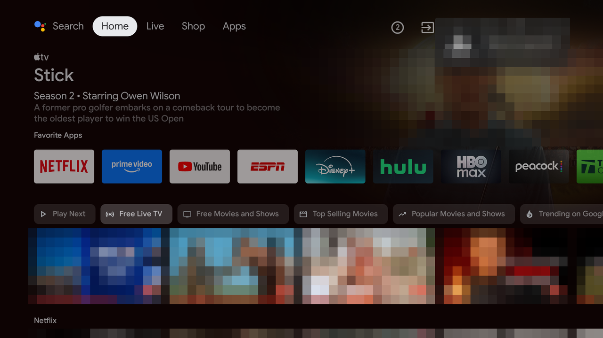
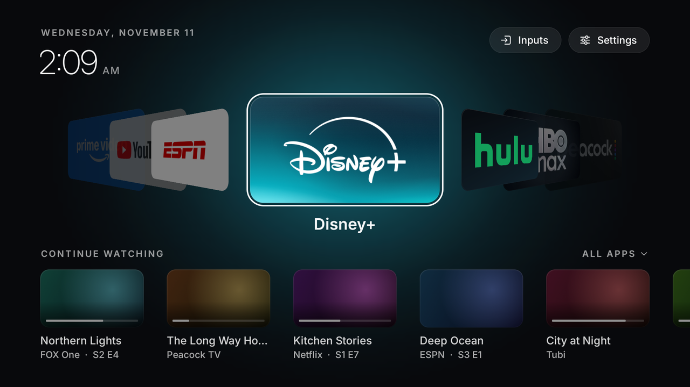
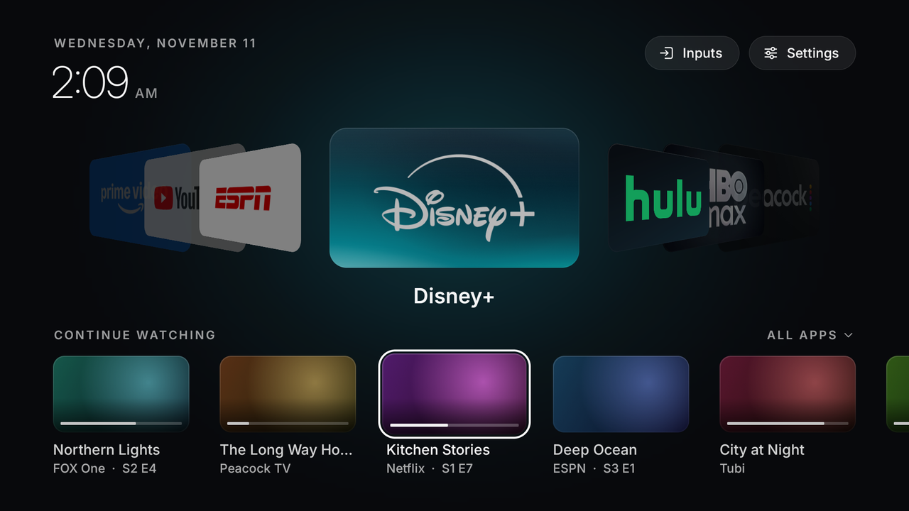
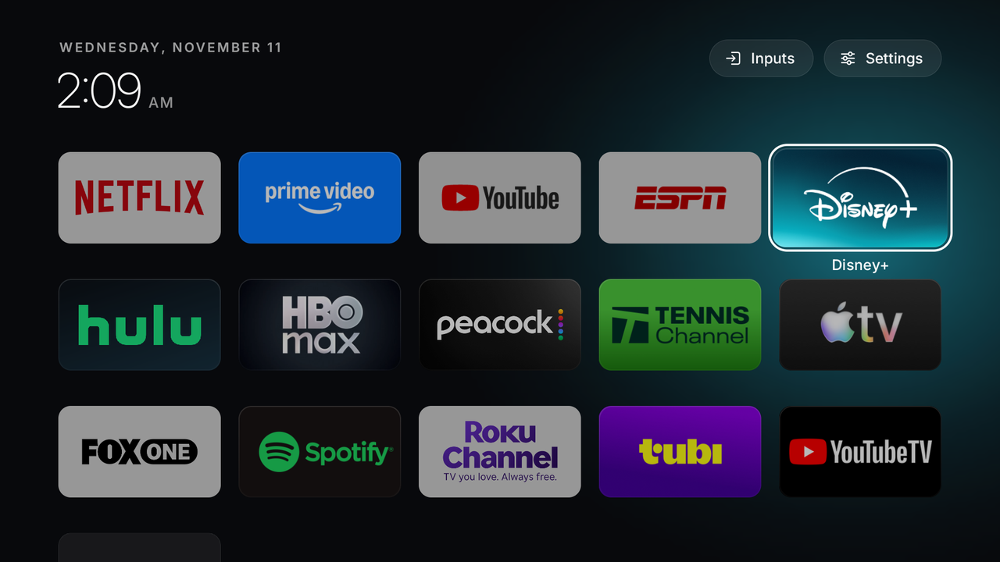
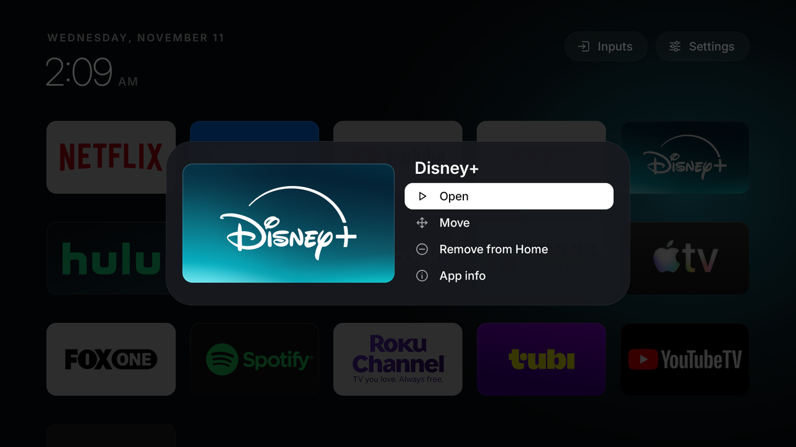

# Android TV tune-up, with a replacement home screen

A way to make an older TCL Android TV fast again without rooting it: remove the preinstalled
bloat, stop it cold-booting every time it is switched on, and replace the ad-heavy home screen
with a small launcher that shows your apps and what you were watching.

Everything is done over `adb`, the TV's own debugging connection. Every change can be undone.

| Before | After |
| --- | --- |
|  |  |

Parts of the "before" image are pixelated: the account picture and a notice, and the
promotional stills the stock home screen was showing. The Continue Watching entries in the
"after" images are the launcher's built-in samples, not anyone's viewing history.

## What it does

1. **Removes preinstalled packages you don't use**: telemetry, promotional messages, the
   manufacturer's own app store and assistant, store demo modes, and similar. They are
   uninstalled for the TV's user, which stops them running and loading at boot, and they can
   be put back.
2. **Fixes slow power-on.** On the TV this was built for, a setting called Quick Start was off,
   which made every power-on a full 35-second boot. With it on, the TV wakes in under two
   seconds.
3. **Replaces the home screen** with the launcher in [`launcher/`](launcher): a carousel of your
   apps, a Continue Watching row, and a grid of everything one press away. No recommendations,
   no ads, no account.

More of the launcher:

| Continue Watching | All apps | Options for an app |
| --- | --- | --- |
|  |  |  |

## Results on one TV

Measured on a TCL 55S434 (Android TV 9, 2 GB RAM). One TV, one set of measurements.

| | Before | After |
| --- | --- | --- |
| Power-on | about 35 s, a cold boot every time | about 1.4 s wake from sleep |
| Home screen app memory | 93 MB | 42 MB |
| Installed packages | 121 | 96 |
| Launcher frame time while the carousel slides | n/a | 12 to 13 ms median |

A cold boot, when one does happen, still takes about 35 seconds. That time is spent in the
bootloader, the kernel and Android's own start-up, and nothing here changes it.

## Will it work on my TV?

It has been run on exactly one model: a **TCL 55S434** on Android TV 9. Treat anything else as
untested.

- **The launcher** needs Android 9 or newer. The install script knows how to step the stock
  home aside only when it is `com.google.android.tvlauncher` (classic Android TV). It has not
  been tried on Google TV, whose home screen is a different app.
- **The package lists** in [`debloat/`](debloat) are for TCL's Android TV 9 firmware. On another
  brand, most of those packages won't exist (the script skips them) and that brand's own bloat
  won't be listed. You would need to write your own list; the manual guide shows how to look.
- **Quick Start** is TCL's name for the setting. Other brands call it Instant On, Fast TV Start
  or similar, or don't have it.
- **Continue Watching** shows only what apps publish to Android TV's Watch Next list. Some
  don't: on the test TV, Netflix published nothing.

## Before you start

You need a computer on the same network as the TV, with `adb` installed, and about half an
hour. To build the launcher you also need a JDK and the Android SDK command-line tools; there
is no prebuilt APK in this repository.

Read [docs/safety.md](docs/safety.md) first. The short version: nothing here is permanent, but
you are removing software from a TV, and on a model this hasn't been tested on you should go
one step at a time and check the TV still behaves after each.

## Two ways to do it

- **By hand:** [docs/manual-setup.md](docs/manual-setup.md) is a complete walk-through with
  every command, using the three scripts in [`scripts/`](scripts).
- **With an AI coding assistant:** [docs/with-an-assistant.md](docs/with-an-assistant.md) has a
  prompt to start from and the ground rules worth insisting on. This is how the project was
  originally done, and it is the better route for a TV model the lists don't cover.

## Undoing it

```sh
scripts/remove-launcher.sh <tv-address>          # back to the stock home screen
scripts/debloat.sh <tv-address> --restore debloat/tcl-core.txt debloat/tcl-optional.txt
```

The settings changes are reversed in the TV's own Settings. Details are in the manual guide.

## Using the launcher

| Where | Remote |
| --- | --- |
| Carousel | Left and Right slide through apps, OK opens the one in the middle, Up goes to Inputs and Settings |
| Continue Watching (Down from the carousel) | OK resumes that show or episode in its app |
| All apps (Down again) | A grid of everything on Home, ending in an "Add app" tile. Up from the top row, or Back, returns to the carousel |
| Any app | Hold OK, or press Menu, for Open, Move, Remove from Home and App info |

Newly installed apps are added to Home automatically. The backdrop takes its color from the
focused app's artwork.

For screenshots that don't show your own viewing history, start it in demo mode:

```sh
adb shell am start -n local.tvhome/.HomeActivity --ez demo true    # false to turn it off
```

The launcher is about 2,500 lines of plain Java with no dependencies, built by
[`launcher/build.sh`](launcher/build.sh) without Gradle. It was tuned for a weak GPU: on the test
TV, elevation shadows and full-screen gradients each cost tens of milliseconds a frame, so it
uses neither.

## What's in this repository

| Path | What |
| --- | --- |
| `launcher/` | The home screen app: source, the Inter typeface, and its build script |
| `debloat/` | Package lists: safe to remove, optional, and the stock home's helpers |
| `scripts/debloat.sh` | Removes or restores the packages in a list, with a dry run |
| `scripts/install-launcher.sh` | Installs the launcher and makes it Home |
| `scripts/remove-launcher.sh` | Switches back to the stock home |
| `docs/` | The guides, the safety notes, and the screenshots |

## License and credits

The code is under the [MIT License](LICENSE). The launcher bundles the
[Inter](https://github.com/rsms/inter) typeface under the SIL Open Font License 1.1
([`launcher/assets/Inter-OFL.txt`](launcher/assets/Inter-OFL.txt)).

This project is not affiliated with or endorsed by TCL, Google, or any streaming service. App
names and logos in the screenshots belong to their owners and appear only as each app draws
itself on a TV where it is installed; none are included in this repository's code.

It was built in one sitting with Claude Code driving the TV over adb, with a second model
reviewing screenshots of the launcher's design between iterations.
